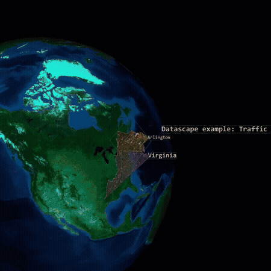
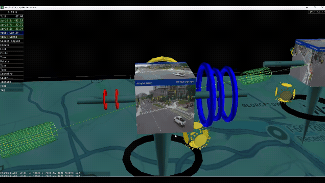
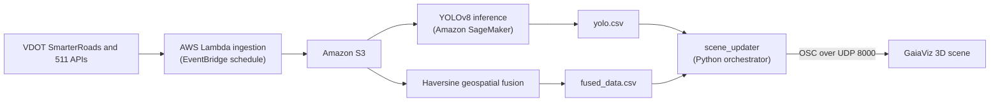

# Traffic-Situational-Awareness-System
A near real-time Situational Awareness system that ingests live traffic camera images and VDOT sensor data from multiple sources, fuses them by location, and updates a 3D scene in GaiaViz.
The system relays information regarding traffic conditions using live traffic cam feeds, the information is processed and its then used to update live 3D Dashboard in GaiaViz tool.  
<p align="center">
  
</p>

<p align="center">
  
</p>

## Problem Statement

Transportation Management Center (TMC) operators need a clear view of what is happening on the road, right now. Today, the information they rely on sits across disconnected dashboards: traffic flow in one, weather in another, cameras and incident reports somewhere else.

During an incident, operators have to correlate these feeds by hand, under pressure, on displays that often refresh only every 30 to 60 seconds. This fragmentation can extend response times by up to 30% during critical events (Endsley & Jones, 2012), and every added minute increases the risk to drivers, pedestrians, and first responders.

**Our question:** how can live traffic, weather, event, and camera data be brought together into a single spatial view, so operators can understand a situation at a glance instead of assembling it across screens?

## What We Built

We built a serverless pipeline and a 3D operational view for Arlington County's I-66 and I-395 corridors. The system:

- **Ingests** live VDOT SmarterRoads and 511 data on an automated schedule
- **Detects** vehicles in roadside camera images with YOLOv8
- **Fuses** streams that update at different rates into one location-aware dataset
- **Translates** GPS coordinates into the GaiaViz scene grid
- **Updates** the 3D scene live, so congestion, weather, camera imagery, and vehicle counts appear together at their real-world positions

## Results

| Measure | Result |
|---|---|
| End-to-end latency (API pull to visible scene update) | Under 10 seconds, compared with 30 to 60 second refresh cycles on traditional 2D dashboards |
| 3D rendering | 120+ FPS in GaiaViz |
| Vehicle detection | Average confidence of 0.68 to 0.74 on about 2,200 images across 5 locations |

## Architecture



1. **Ingestion:** EventBridge triggers Lambda functions every 5 minutes. Each statewide cycle collects 1,255 sensor records, and the raw data lands in S3.
2. **Detection:** A pretrained YOLOv8 model on SageMaker counts cars, trucks, and buses in camera images, using a confidence threshold of 0.25.
3. **Fusion:** Each sensor record is matched to its nearest weather station and event within a set distance, using the Haversine formula. This joins streams with no shared key and different update rates (traffic about every minute, weather every 5 to 10 minutes).
4. **Coordinate translation:** A reusable Python CLI tool converts GPS coordinates to GaiaViz subgrid positions with a slope-intercept mapping (`Y = MX + B`). It runs on both macOS and Windows.
5. **Scene update:** `scene_updater` runs on a 30-second cycle. It reads the latest outputs, computes the state of each node, backs up and rewrites the node file, and sends OSC messages so GaiaViz picks up the changes live.

## Data

The system uses **live data only**.

| Stream | Coverage | Used for |
|---|---|---|
| Traffic sensors | 115 sensors in Arlington | Occupancy and congestion state on corridor links |
| Weather stations | 10 stations | Environmental conditions at each location |
| Events | Filtered to Arlington | Incident context in the fused dataset |
| Roadside cameras | 5 corridor locations | Vehicle counts and live imagery in the scene |

Camera images were narrowed in stages to protect data quality:

| Stage | Images |
|---|---|
| Raw frames collected | About 400,000 |
| After quality filtering (low-light frames removed) | About 25,000 |
| Run through YOLOv8 evaluation | About 2,200 |

## Reading the 3D Scene

The scene contains 92 nodes, including 5 hyperglyphs that each carry 9 leaf nodes (3 vehicle clusters across the 3 most recent time snapshots).

| Visual element | What it shows |
|---|---|
| Link color | Worst-case occupancy along a corridor segment |
| Red leaf | `bus_count`, used as the emergency-vehicle cluster |
| Yellow leaf | `truck_count` |
| Blue leaf | `car_count` |
| Grey leaf | Zero detections |
| Leaf scale | Size of the vehicle count |
| Camera and weather cubes | Latest imagery, applied as textures |

## Repository Structure

```text
.
├── ingestion/          # AWS Lambda functions for live data collection
├── detection/          # YOLOv8 inference on SageMaker
├── fusion/             # Haversine nearest-neighbor fusion
├── scene_updater/      # 6-module orchestrator; config.py holds all field mappings
├── tools/              # GPS-to-subgrid coordinate translation CLI
├── data/sample/        # Small sample outputs for reference
├── docs/               # Project report, diagrams, and demo assets
├── requirements.txt
└── README.md
```

## Quickstart

### Prerequisites

- Python 3
- An AWS account with access to Lambda, EventBridge, S3, and SageMaker
- VDOT SmarterRoads and 511 API access
- GaiaViz installed locally

### Setup

```bash
git clone https://github.com/Shub-1201/Traffic-Situational-Awareness-System.git
cd Traffic-Situational-Awareness-System
pip install -r requirements.txt
```

### Run the scene updater

Open the scene in GaiaViz, then start the orchestrator:

<!-- TODO: confirm the entry point -->

```bash
python -m scene_updater
```

Parts of the update can be skipped independently:

```bash
python -m scene_updater --skip-leaves    # Skip vehicle count leaves
python -m scene_updater --skip-textures  # Skip camera and weather images
python -m scene_updater --skip-links     # Skip corridor link colors
```

## Engineering Challenges

| Challenge | Root cause | Resolution |
|---|---|---|
| Camera pulls read the wrong hour of data | The script used local Eastern time while S3 folders followed UTC | Standardized folder resolution on UTC |
| Lambda functions failed at runtime | PIL, NumPy, and Pandas dependency packaging conflicts | Built proper Lambda layers |
| API schema changes threatened to break the pipeline | Column renames and a field type change arrived mid-sprint | Isolated field mappings in `config.py`, limiting changes to two files |
| Scene updates moved the wrong elements | Parent node transforms propagate to their children | Enforced a leaf-node-only update rule |
| Values were altered when written to CSV | Pandas stripped trailing zeros | Applied explicit float formatting |

## Scope and Limitations

- Coverage is limited to Arlington County's I-66 and I-395 corridors.
- The system uses live data only and does not include crash or historical analysis.
- YOLOv8 was used as a pretrained baseline because no labeled corridor dataset was available. The reported confidence scores are not a measure of precision or recall.
- The model has no dedicated emergency-vehicle class, so that cluster is populated from `bus_count`.

## Tech Stack

**Cloud:** AWS Lambda, EventBridge, S3, SageMaker
**Languages and data:** Python, Pandas, NumPy
**Computer vision:** YOLOv8
**Visualization:** GaiaViz, OSC over UDP
**Data sources:** VDOT SmarterRoads, 511

## Acknowledgments

This project was developed by **Team Dominion** as part of **DAEN 690 at George Mason University**.

We would like to express our sincere gratitude to our advisor, **Dr. James Baldo**, for his valuable guidance, mentorship, and support throughout the project.

We also extend our appreciation to **Claire Saxon, Shane Saxon, and the GaiaViz team** for their collaboration, insights, and continuous support as our client partners. Their feedback and expertise were instrumental in shaping the development and successful completion of this project.
